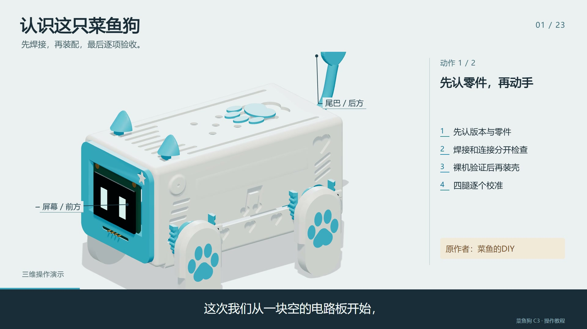

# 菜鱼狗 · 从焊接到整机 / Caiyu Dog: From Soldering to Assembly

**中文三维互动教程与完整视频 · Chinese interactive 3D tutorial and full video**

面向第一次制作菜鱼狗 C3 的朋友：用清晰的三维近景，逐步学习焊接、接线、检查、校准与装配。教程包含 **23 章、46 个动作**，支持暂停、回放、模型旋转缩放、逐根接线高亮和浏览器进度保存。

An independent learning companion for a first Caiyu Dog C3 build. Follow **23 chapters and 46 actions** covering soldering, wiring, inspection, calibration and assembly, with interactive 3D views, pause/replay, wire highlighting and browser-local progress.

**语言 / Language:** 本项目说明与版本说明使用中英双语；网页界面、旁白和视频字幕为中文。 / Project documentation and release notes are bilingual. The tutorial interface, narration and video subtitles are in Chinese.



## 开始学习 / Start learning

| 内容 / Content | 链接 / Link |
| --- | --- |
| GitHub 在线互动教程 / Interactive tutorial on GitHub Pages | [打开教程 / Open tutorial](https://zth464204365.github.io/caiyu-dog-tutorial/) |
| 已有公开在线版 / Existing public website | [打开在线版 / Open website](https://caiyu-dog-assembly-lab.dark-scout-6141.chatgpt.site) |
| 完整视频，约 11 分 06 秒 / Full video, approximately 11:06 | [YouTube · 中文 3D 制作教程 / Chinese 3D build tutorial](https://youtu.be/-llGUxT8bvs) |
| 离线网页版 / Offline interactive tutorial | [下载 ZIP / Download ZIP](https://github.com/zth464204365/caiyu-dog-tutorial/releases/download/v1.0.0/caiyu-dog-interactive-offline-v1.0.0.zip) |
| 1080p 原版视频 / Original 1080p video | [下载 MP4 / Download MP4](https://github.com/zth464204365/caiyu-dog-tutorial/releases/download/v1.0.0/caiyu-dog-tutorial-1080p-zh.mp4) |
| 中文字幕 / Chinese subtitles | [下载 SRT / Download SRT](https://github.com/zth464204365/caiyu-dog-tutorial/releases/download/v1.0.0/caiyu-dog-tutorial-zh.srt) |
| 中英双语章节 / Bilingual chapter index | [查看章节 / View chapters](downloads/chapters-zh-en.txt) |
| 全部下载与校验 / All downloads and checksums | [Releases](https://github.com/zth464204365/caiyu-dog-tutorial/releases/latest) |

在线版无需安装。公开访客可以观看教程和视频；提出改进请使用 Issue 或 Pull Request。网站不会授予访客修改仓库的权限。

The online tutorial requires no installation. Visitors can view the tutorial and video; feedback is welcome through Issues and Pull Requests. Viewing the website does not grant repository write access.

## 使用互动工作台 / Use the interactive workbench

1. 在左侧目录选择章节；手机点“完整目录”。 / Choose a chapter in the sidebar; on mobile, open “完整目录” (Contents).
2. 点“演示本步”观看动作，可暂停、重播或拖动进度。 / Start an action with “演示本步” (Play action), then pause, replay or scrub.
3. 点“自由观察”旋转模型，使用滚轮或按钮缩放，再恢复教学机位。 / Use “自由观察” (Inspect) to rotate and zoom, then restore the teaching view.
4. 在“接线表”中点击一根线，查看两端和连接关系。 / Select a wire in “接线表” (Wiring) to inspect its endpoints and connection.
5. 看完后点“确认并继续”；在“检查”中记录你亲自核对的实物项目。 / Continue after reviewing the action and record your own hardware checks in “检查” (Checks).

学习与检查记录保存在当前浏览器，资料页可以导出 JSON。网页不连接或控制实物；模拟动作与学习完成状态不代表实物已通过验收。

Learning progress and manually checked items stay in the current browser and can be exported as JSON. This site does not connect to or control hardware. Completing an animation is not evidence that a physical robot has passed inspection.

## 学习顺序 / Learning sequence

- 准备、认零件、PCB 两面与焊接。 / Preparation, parts, PCB orientation and soldering.
- 屏幕、麦克风、功放、触摸、灯带与四腿接线。 / Wiring the display, microphone, amplifier, touch sensor, LEDs and four servos.
- 断电检查、烧录与核心功能测试。 / Inspection, flashing and core-function tests.
- 打印件试合、内部布局、摆臂与腿装配、收线合壳。 / Dry-fitting printed parts, placing modules, assembling horns and legs, routing wires and closing the shell.
- 校准保存、重启复测与问题排查。 / Saving calibration, testing after reboot and troubleshooting.

## 本地运行 / Run locally

**免安装下载 / Offline download:** 完整解压 Release 中的离线 ZIP，双击 `菜鱼狗_互动教程_免安装版.html`，保留旁边的 `caiyu-interactive-tutorial` 文件夹。模型、配音和配套视频均已包含。使用支持 WebGL 的现代 Edge 或 Chrome。

Extract the complete offline ZIP from Releases, open `菜鱼狗_互动教程_免安装版.html`, and keep the adjacent `caiyu-interactive-tutorial` folder. Geometry, narration and the companion video are included. Use a modern WebGL-capable browser such as Edge or Chrome.

**源码运行 / Run from source:** 需要 Python 3，不需要 npm 构建或联网安装依赖。 / Requires Python 3; no npm build or dependency download is needed.

```sh
git clone https://github.com/zth464204365/caiyu-dog-tutorial.git
cd caiyu-dog-tutorial
python serve.py
```

打开 / Open [http://127.0.0.1:4188](http://127.0.0.1:4188)。Windows 也可双击 `启动教程.cmd`。不要直接打开源码中的 `index.html`，浏览器会限制本地模块读取。 / Windows users can also double-click `启动教程.cmd`. Serve the source over HTTP rather than opening `index.html` directly, because browsers restrict local module access.

## 文件结构 / Files

```text
index.html, style.css, app.js   网页与学习交互 / Website and learning controls
engine.js, models.js           三维动作与模型 / 3D actions and models
lesson-data.json              讲解与时间数据 / Instructions and timing
assets/models/                教学几何与 PCB 数据 / Geometry and PCB data
assets/voice-paced/            中文配音 / Chinese narration
downloads/                    720p 网页视频、GLB、字幕、章节 / Web video, GLB, subtitles, chapters
vendor/                       Three.js 运行库 / Three.js runtime
serve.py                      本地服务，支持视频定位 / Local server with video seeking
NOTICE.md                     来源与第三方条款 / Credits and third-party terms
```

网页内视频为 720p 轻量版；1080p 原版作为 Release 文件提供。GLB 是教学观察模型，制造和打印请使用作者原始打印文件。

The embedded web video is a lightweight 720p copy; the original 1080p video is available as a Release asset. The GLB is a teaching model. Use the author's original print files for fabrication.

## 原作者与资料 / Original author and sources

机器人原项目来自 **菜鱼的DIY / Zohlz**。本教程是独立教学整理，不是原作者的官方教程或实物验收记录。主要外壳网格采用作者的模型 3020128；电子模块、工具、线材和教学动作另行重建，PCB 位置与网络根据作者工程整理。

The original robot project is by **菜鱼的DIY / Zohlz**. This independent learning companion is not an official tutorial or proof of a completed physical build. The main shell meshes derive from the author's model 3020128; electronic modules, tools, wires and teaching actions were reconstructed, and PCB positions and nets were derived from the author's project.

- [作者源码 / Author's source repository](https://github.com/Zohlz/xiaozhi-esp32-caiyudog)，对应提交 / reference commit `15d8263aaf07574b45f837efd905d8988cb59fba`。
- [作者完整教程 / Author's full build tutorial](https://www.bilibili.com/video/BV1E6hb64EV2)。
- [原始打印模型 3020128 / Original printable model 3020128](https://makerworld.com.cn/zh/models/3020128-cai-yu-gou-di-cheng-ben-zhi-neng-xiao-gou)。

实际板卡修订、模块针序、供电规格和装配公差以收到的匹配材料包为准。 / Check the actual board revision, module pin order, power requirements and fit against your matching hardware kit.

Three.js 遵循 MIT；配音使用 Breeze TTS 2 原创声线，没有克隆原作者声音。第三方模型、音频和视频各自的条款见 [NOTICE.md](NOTICE.md)，本仓库没有将全部资源统一重新许可。 / Three.js uses the MIT license. Narration uses an original Breeze TTS 2 voice, not a clone of the original author's voice. See [NOTICE.md](NOTICE.md) for third-party terms; this repository does not relicense all included assets under one blanket license.
